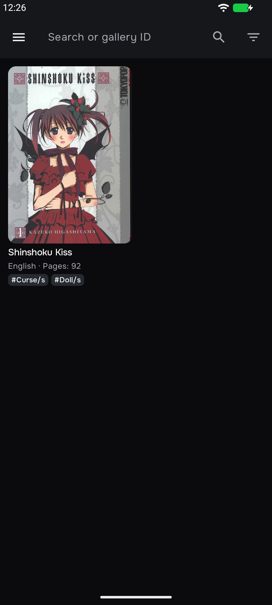
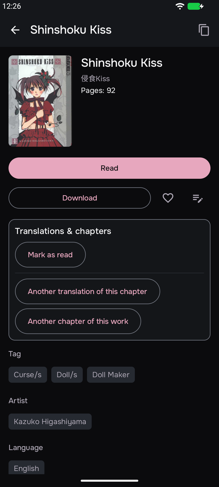

# Peachy

Your photos, videos and reading, in one Android app. Peachy combines a local media library, a player, an HTTPS browser and an adult manga reader, with optional device sync through Intiface Central.

**Android 8.0+ · v0.9.3 (versionCode 19) · English / Русский · AGPL-3.0**

Capabilities below describe the **0.9.3 source**, not a claim about every older APK.

[Download APK](https://github.com/spgsroot/Peachy/releases/latest) · [Website](https://peachyproject.org/) · [Русский](README_RU.md) · [Privacy](#privacy-and-network) · [Build](#build)

## Install

Open the [latest release](https://github.com/spgsroot/Peachy/releases/latest), download the **`.apk` under Assets**, and open it on your Android phone. Allow installation from the app that opened the file if Android asks. The `.aab` is not for direct installation.

Set an app password, then import photos/videos or share them to Peachy. Local playback and photo browsing need no online account. Open the browser, catalog, translation or device connection only if you want those features.

## What you can do

| Workspace | Available now |
|---|---|
| Library | Photos and videos together: All / Videos / Photos / Albums, search, name/size sorting, size filters and adjustable tiles. Rename, delete and move mixed selections between albums. Photos open in an EXIF-aware zoom viewer. |
| Player | Local video on Media3 ExoPlayer: queue, speed, timer, seek gestures, brightness/volume and zoom. Video-only tools include covers, notes, folder export and single/batch HEVC or H.264 compression. |
| Browser | HTTPS tabs with previews, bookmarks, history, notes and native Brave ad/tracker filtering. Save video files found on a page; HLS/DASH stream downloading is unsupported. |
| Manga (18+) | Browse nhentai by tags, save galleries/pages, resume reading, zoom and use continuous or paged layouts. “For you” ranks recommendations on the device; fetching candidates still uses the network. |
| Documents | View/edit supported images and PDFs on working copies. Recognising an Office format is **not** Office editing: see [format limits](#documents-and-format-limits). |
| Optional extras | Audio-driven compatible devices through Buttplug / Intiface Central, manga translation with your chosen provider, and password-encrypted `.peachy` library exports. |

The native Kotlin/Jetpack Compose app has a dark graphite-and-rose interface with bundled Onest. Android is available; desktop and alternative-network integrations are roadmap/research, not shipped features.

### Media and device limits

- Photos are copied into app-private storage, validated and thumbnailed; each photo is limited to **100 MiB**, including shares with no declared size. A photo/video belongs to at most one album. Deleting an album leaves its files in the library.
- Compression and gallery folder export are **video-only**. Compression replaces an original only with a smaller, validated result; unsupported HEVC output falls back to H.264. Cancellation keeps the original.
- Video duplicate checks use SHA-256. In-app import offers Skip / Add anyway; browser/shared-link imports report duplicates.
- File-host import supports public video links/albums on Bunkr, Cyberdrop, Turbo, Pixeldrain and Filester, plus findr.to album indirection. Images and archives are skipped. Password albums, GoFile and FileDitch are unsupported; Turbo downloads remain unverified because its CDN was unreachable from the test machine.
- Browser/Android Share downloads inside Peachy require public HTTPS destinations, rechecked at each redirect. Cookies and the referring URL are not forwarded across origins. Peachy is offered as a video downloader, not as a default web browser.
- Intiface defaults to `ws://127.0.0.1:12345`; plaintext `ws://` is loopback-only. Remote connections require trusted `wss://`. Intiface, not Peachy, scans for devices. Bass range, smoothing, threshold and boost map audio amplitude to supported vibration, oscillation, rotation or position actuators. Browser page-audio capture is off until enabled.

## Browser shield

The browser embeds the **source-built native Brave engine** on all four Android ABIs; it is not the Brave browser. Bundled EasyList, EasyPrivacy and Peachy Adult filters provide an offline baseline. The menu adds subscriptions, custom rules, per-site exceptions and page/lifetime counts. Initial/three-day refresh and manual updates contact list publishers and retain the previous working generation on failure.

Pages are HTTPS-only. Cross-site links/redirects and user-opened new windows need confirmation; unprompted windows are refused. The address bar, bookmarks and history open destinations directly. Camera, microphone, location and file chooser access are denied; third-party cookies and WebView debugging are off. Tab state is encrypted with an Android Keystore key. Clearing visits and clearing site data are separate actions.

Filtering is limited by WebView interception: not every redirect, cached load, service-worker request or WebSocket is visible. It is not a guarantee that every ad, tracker or navigation is blocked. See [build requirements, filter behaviour and WebView limits](native/adblock/README.md).

## Documents and format limits

Documents preserve the imported source and edit a separate working copy; **Save a copy** delivers a result through Android's file picker.

| Family | Regular-build support |
|---|---|
| Images | Edit PNG, JPEG, WebP, BMP and supported HEIC/HEIF: crop, rotate (including free angle), adjust brightness/contrast/saturation, draw, undo/redo, export PNG/JPEG. Animated WebP edits only its first frame; HEIC decoding depends on the platform. JPEG flattens transparency onto white. |
| PDF | MuPDF-based viewing, zoom, thumbnails, search/copy/text export, annotations, forms, page operations, undo and PDF/page-image export. Text replacement is limited, without reflow, and unsafe runs are refused; wider text can overlap neighbouring content. |
| Word / Excel / PowerPoint | Recognised files can be imported/listed, but **Office viewing/editing is disabled**. This includes legacy `.xls`, `.xlsx`, `.xlsm`, `.xlsb`, ODS, CSV and TSV: recognition does not make them usable spreadsheets. |

Import caps: PDF/images 100 MiB, Word 50 MiB, Excel 25 MiB, PowerPoint 100 MiB; free-space reserve 50 MiB. PDFs also have a 5,000-page cap and bounded render sizes. AVIF, ODP, DOTM, PPTM and encrypted Office containers are unsupported.

A drawn PDF signature is ink, **not** a cryptographic signature. PKCS#12 signing and signature status are implemented, but independent signature verification and native form appearance coverage remain limited; do not infer legal validity or universal compatibility. Editing a signed PDF can invalidate its signatures.

The optional LibreOffice engine can be packaged for isolated debug work, one verified `arm64-v8a` or `x86_64` stage per APK. **Office remains disabled** until macro and external-link isolation are demonstrated; packaging an engine is not releasing an editor.

Source details for 3.7.0: [import formats/caps](app/src/main/java/ru/spgsroot/peachy/documents/DocumentFormats.kt) · [image editor](app/src/main/java/ru/spgsroot/peachy/documents/image/) · [PDF implementation](app/src/main/java/ru/spgsroot/peachy/documents/pdf/) · [Office gate](app/src/main/java/ru/spgsroot/peachy/documents/office/ui/OfficeEntryPolicy.kt).

JPEG export composites transparency without a full-image `IntArray`, avoiding that temporary allocation. See the [raster implementation](app/src/main/java/ru/spgsroot/peachy/documents/image/ImageRaster.kt) and [JPEG memory regression test](app/src/androidTest/java/ru/spgsroot/peachy/documents/image/ImageRasterJpegMemoryTest.kt); this is not an app-wide speed or memory guarantee.

## Privacy and network

**The password locks the interface; it does not encrypt each media file.**

- The in-app keypad accepts a non-empty **numeric** password with no fixed length. Letters cannot be entered on it. Failed attempts increase the wait.
- SQLCipher encrypts the database using a separate random key protected by Android Keystore, not the app password. Media, thumbnails and working documents are app-private files, not individually encrypted by Peachy. Android's sandbox/device encryption and phone security still matter; a compromised device is outside this protection.
- App windows use `FLAG_SECURE`. Rotation preserves the unlocked session; Home, Recents, screen-off and restart lock it. Known exception: going Home during a system file picker, returning and cancelling it leaves Peachy unlocked.
- Local media use does not need the browser, catalog, translation or update service. Those features contact sites, nhentai, your provider or GitHub; filter updates contact publishers. Local-first is **not** offline-only or anonymous browsing.
- Translation requires consent naming the provider host. Vision mode sends page images; on-device OCR mode sends recognised text. Provider keys stay encrypted on the phone and are excluded from the database and `.peachy` export. Providers may charge or refuse adult pages. Local detection uses ML Kit, with an additional YOLO26n path on arm64.
- Private notes stay in the local encrypted database; library exports can include them. The nhentai API key shipped in source/APK is public, not a user secret. Posting nhentai comments is unavailable.

### Backup and updates

A `.peachy` library export uses its **own password**, AES-256-GCM and a PBKDF2-SHA256 key. It includes media/thumbnails, albums, saved manga/pages, histories, tags, notes, browser data and cached translations. Format 3 reads formats 1 and 2; import adds rather than deletes, and newer notes/translations win. App password, device settings and provider key are excluded. This is a library backup, not a promise to back up document working sessions. A forgotten archive password cannot be recovered. Separately exported files are not encrypted by Peachy.

**Settings → Peachy updates** checks the latest stable GitHub release and downloads its APK on request. Automatic daily checks are **off by default** and run only while Peachy is open and unlocked. The updater checks size, GitHub SHA-256, app identity, versionCode and minimum Android version; Android verifies the signature and asks before installing.

**Moving from Peachy 3.x to 0.9.x:** download the [signed APK from the latest release](https://github.com/spgsroot/Peachy/releases/latest) and install it over the existing app. Do not uninstall Peachy. The old updater does not offer lower version names, but Android recognizes the higher `versionCode`.

More: [manga reader](docs/manga-reader.md) · [detector runtime and limits](docs/detector-runtime.md) · [recorded usability checks](docs/reports/2026-11-14-usability.md) · [changelog](CHANGELOG.md).

## Screens and design

**[Browse the Android feature gallery](repo/screens-v0.9.3/)** · [Player & import](repo/screens-v0.9.3/#плеер-и-импорт) · [Media library](repo/screens-v0.9.3/#медиатека) · [Documents](repo/screens-v0.9.3/#документы) · [Settings & backup](repo/screens-v0.9.3/#настройки) · [Devices](repo/screens-v0.9.3/#устройства) · [Browser](repo/screens-v0.9.3/#браузер)

**[Manga walkthrough · 0.9.4](repo/screens-v0.9.4/)** — follow *Shinshoku Kiss* from the catalog to the reader, then see how Peachy links chapters and translations. The 0.9.3 gallery above records the rest of the app and labels capture gaps.

| Catalog | Gallery details | Reader |
|:---:|:---:|:---:|
|  |  |  |

See the [website](https://peachyproject.org/) for the new design and [DESIGN.md](DESIGN.md) for the native design record. Its Library/Player previews and the banner use genuine newer Android captures with sample media; the NASA browser preview was captured in Chromium, **not** in Peachy's browser.

<details>
<summary>Historical screenshots — before the current rebrand</summary>

All captures in [`repo/screens/`](repo/screens/) predate the graphite-and-rose interface. They document earlier workflows, not current appearance. Clips are samples; adult catalog covers/titles are pixelated, and the reader shows settings over a pixelated page.

| Library | Player | Browser |
|:---:|:---:|:---:|
|  |  |  |

</details>

Banner sample photos: [Yulia Gadalina](https://unsplash.com/photos/snow-mountain-l0ascMtIQSw), [Thomas Griesbeck](https://unsplash.com/photos/evergreen-trees-in-dense-mountain-fog-BS-Uxe8wU5Y), [Kimberly Genest](https://unsplash.com/photos/grayscale-photo-of-desert-under-cloudy-sky-UTZz666yXMs), [Elisa Kerschbaumer](https://unsplash.com/photos/rocky-cliff-overlooking-the-ocean-at-dusk-jg87InsEu9Y), [Ingrid Koe](https://unsplash.com/photos/gray-forest-with-fog-kbKEuU-YEIw), [Hunter Masters](https://unsplash.com/photos/a-mountain-covered-in-snow-with-low-clouds-R4J45_iSxeY), under the [Unsplash License](https://unsplash.com/license). Onest: SIL OFL 1.1.

## Build

Requirements: Android SDK Platform 36 (minSdk 26, target/compileSdk 36), JDK 17+ compatible with the project Gradle wrapper, and the pinned Python/Rust/NDK toolchain in the [native blocker guide](native/adblock/README.md). A JDK and Android SDK alone are not enough for the source-built blocker.

```sh
./gradlew :app:assembleDebug
```

On Windows: `.\gradlew.bat :app:assembleDebug`. Output: `app/build/outputs/apk/debug/`.

`assembleRelease` produces an unsigned APK. [GitHub Actions](.github/workflows/release.yml) signs release builds with repository secrets on a `v*` tag or manual dispatch.

[Source](https://github.com/spgsroot/Peachy) · [GNU AGPL v3.0](LICENSE) · [Third-party notices](NOTICE)
