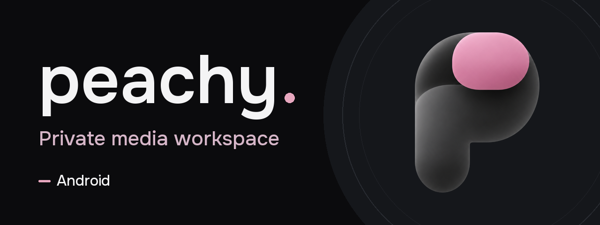

# Peachy

Peachy is an open-source, local-first media workspace for Android. Organize photos and videos into albums, play videos without leaving your library, and browse the web in the same app. Imported media stays in the app's private storage on your phone. The interface is available in English and Russian.

**[Download for Android](https://github.com/spgsroot/Peachy/releases/latest)** · [Peachy website](https://peachyproject.org/) · [Русский](README_RU.md)

## Install

Peachy runs on **Android 8.0 or later**. Open the [latest release](https://github.com/spgsroot/Peachy/releases/latest), download the `.apk` under **Assets**, and open it on your phone. Android may ask you to allow installs from the app that opened the file. The `.aab` is not for direct installation.

To check for an update from Peachy, open **Settings → Peachy updates**. Android still asks you to confirm installation.

## What you can do

- **Library.** Import photos and videos from Android's share menu, organize them into albums, and search or sort your collection. Open photos full-screen, or compress and export videos.
- **Player.** Play local videos with a queue, playback speed controls, and a timer that switches clips. Optionally drive compatible haptic devices from player or browser audio through Intiface Central.
- **Browser.** Open HTTPS sites with tabs, bookmarks, history, and an ad and tracker blocker. Save supported video files to your library; HLS and DASH streams cannot be saved.
- **Manga.** Browse the adult nhentai catalog, read and save galleries and pages, and optionally translate pages with a provider you configure. See the [manga reader guide](docs/manga-reader.md).

| Library | Player | Browser |
|:---:|:---:|:---:|
|  |  |  |

Screenshots are from an earlier interface. See the [website](https://peachyproject.org/) for the new Peachy design.

## What stays on your phone

The app lock controls access to Peachy's interface. The database is encrypted; imported media files are not individually encrypted by Peachy and rely on Android's app sandbox and device encryption. You can export an encrypted `.peachy` backup protected by a separate password. Files exported individually are not encrypted by Peachy.

The browser contacts the sites you open, and the manga catalog contacts nhentai. Optional page translation sends page images or text recognized on the phone, depending on the mode, to the provider you configure after you approve that host. Peachy is not an anonymity tool.

## Build from source

Use **JDK 17** and the **Android SDK Platform 36**. The app is written in Kotlin with Jetpack Compose.

```sh
./gradlew :app:assembleDebug
```

On Windows, use `.\gradlew.bat :app:assembleDebug`. The debug APK is written to `app/build/outputs/apk/debug/`.

Peachy is licensed under the [GNU Affero General Public License v3.0](LICENSE).
