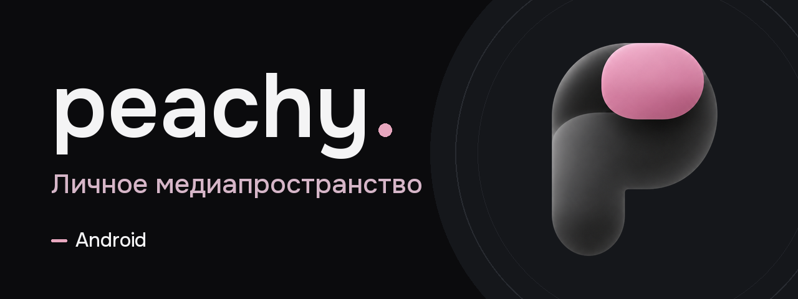
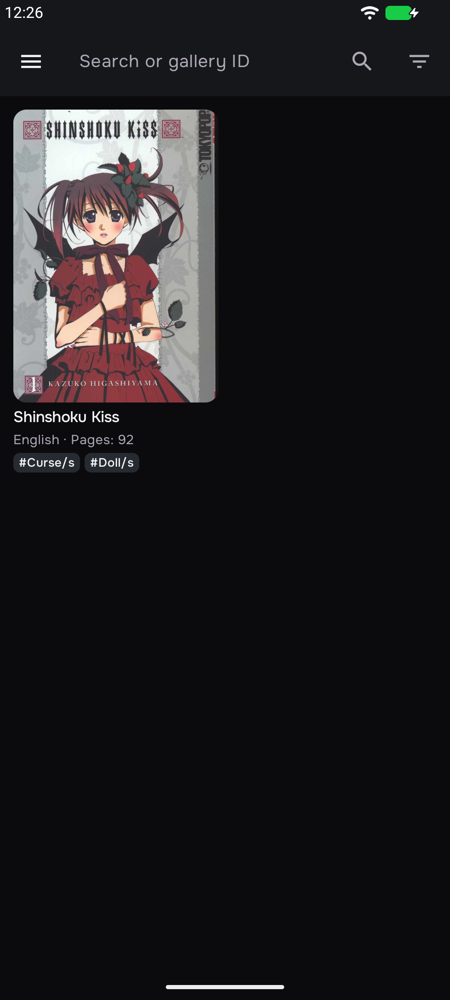
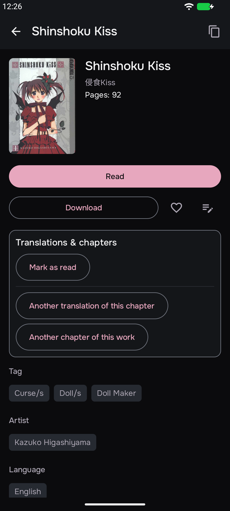
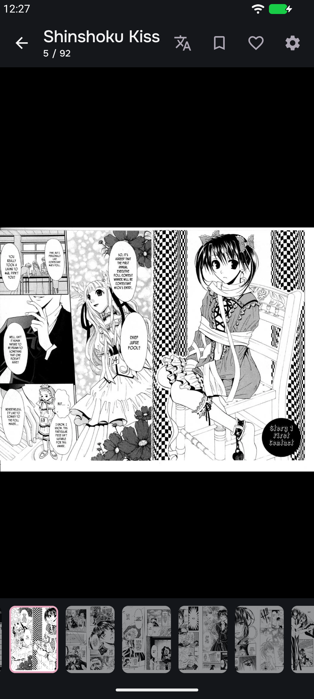

# Peachy

Фотографии, видео и чтение — в одном приложении для Android. Peachy объединяет локальную медиатеку, плеер, HTTPS-браузер и ридер манги 18+, а при желании синхронизирует совместимые устройства через Intiface Central.

**Android 8.0+ · v0.9.4 (versionCode 20) · Русский / English · AGPL-3.0**

Ниже описаны **исходники версии 0.9.4**, а не возможности каждого старого APK.

[Скачать APK](https://github.com/spgsroot/Peachy/releases/latest) · [Сайт](https://peachyproject.org/) · [English](README.md) · [Приватность](#приватность-и-сеть) · [Сборка](#сборка)

## Установка

Откройте [последний релиз](https://github.com/spgsroot/Peachy/releases/latest), скачайте **`.apk` из раздела Assets** и откройте его на Android. Если система попросит, разрешите установку из приложения, открывшего файл. `.aab` не предназначен для прямой установки.

Задайте пароль приложения, затем импортируйте фото/видео или отправьте их в Peachy через «Поделиться». Для локального просмотра сетевой аккаунт не нужен. Браузер, каталог, перевод и подключение устройств можно не использовать.

## Что уже работает

| Раздел | Возможности |
|---|---|
| Библиотека | Фото и видео вместе: вкладки «Все», «Видео», «Фото», «Альбомы», поиск, сортировка по имени/размеру, фильтр размера и настройка плиток. Переименование, удаление и перенос смешанного выделения между альбомами. Фото открываются в просмотрщике с зумом и учётом EXIF. |
| Плеер | Локальное видео на Media3 ExoPlayer: очередь, скорость, таймер, жесты перемотки, яркости/громкости и масштаба. Только для видео: обложки, заметки, выгрузка в папку и одиночное/групповое сжатие HEVC или H.264. |
| Браузер | HTTPS-вкладки с миниатюрами, закладки, история, заметки и нативная фильтрация рекламы/трекеров на Brave. Можно сохранить видеофайл со страницы; скачивание потоков HLS/DASH не поддерживается. |
| Манга 18+ | Каталог nhentai с тегами, группировка и связь переводов/глав с отдельной позицией чтения у каждого перевода, сохранение галерей/страниц, продолжение чтения, зум, непрерывный и постраничный режимы. Рекомендации «Для вас» рассчитываются на устройстве, но кандидаты загружаются из сети. |
| Документы | Просмотр/редактирование поддерживаемых изображений и PDF на рабочих копиях. Распознать формат Office — **не значит** уметь его редактировать: см. [ограничения форматов](#документы-и-ограничения-форматов). |
| По желанию | Управление совместимыми устройствами от звука через Buttplug / Intiface Central, перевод манги выбранным провайдером и архивы библиотеки `.peachy` под отдельным паролем. |

Нативное приложение на Kotlin/Jetpack Compose использует тёмный графитово-розовый интерфейс со встроенным Onest. Android доступен; настольная версия и альтернативные сети остаются планами/исследованиями, а не готовыми функциями.

### Ограничения медиа и устройств

- Фото копируются в закрытую папку приложения, проверяются и получают миниатюры. Лимит — **100 МиБ на фото**, даже если отправитель не сообщает размер. Фото/видео входит максимум в один альбом; удаление альбома не удаляет его файлы.
- Сжатие и выгрузка из галереи в папку доступны **только для видео**. Сжатие заменяет оригинал лишь более компактным проверенным результатом; при неподдерживаемом HEVC используется H.264. Отмена сохраняет оригинал.
- Дубли видео проверяются по SHA-256. При импорте в приложении есть выбор «Пропустить / Добавить всё равно»; браузер и загрузка из «Поделиться» сообщают о дубле.
- Импорт с файлообменников поддерживает открытые видеоссылки/альбомы Bunkr, Cyberdrop, Turbo, Pixeldrain, Filester и переход от альбома findr.to к исходному. Картинки и архивы пропускаются. Альбомы с паролем, GoFile и FileDitch не поддерживаются; загрузки Turbo не проверены — CDN был недоступен с тестовой машины.
- Скачивание внутри Peachy из браузера или Android «Поделиться» принимает публичные HTTPS-адреса и проверяет каждый редирект. На другой origin не передаются cookie и адрес исходной страницы. Peachy предлагается как загрузчик видео, а не браузер по умолчанию.
- Адрес Intiface по умолчанию — `ws://127.0.0.1:12345`; незашифрованный `ws://` разрешён только для loopback. Удалённому серверу нужен доверенный `wss://`. Устройства ищет Intiface, не Peachy. Диапазон низких частот, сглаживание, порог и усиление преобразуют амплитуду в команды вибрации, осцилляции, вращения или позиции. Захват звука страницы выключен до явного включения.

## Блокировка в браузере

Браузер использует **нативный движок Brave, собранный из исходников**, для всех четырёх Android ABI; это не браузер Brave. Встроенные EasyList, EasyPrivacy и Peachy Adult дают исходную фильтрацию без сети. В меню доступны подписки, свои правила, исключения для сайтов и счётчики страницы/за всё время. Первоначальная, трёхдневная и ручная проверки обращаются к издателям списков и сохраняют предыдущее рабочее поколение при сбое обновления.

Страницы открываются только по HTTPS. Переход по ссылке/редиректу на другой сайт и новое окно после нажатия требуют подтверждения; самопроизвольные окна отклоняются. Адресная строка, закладки и история открывают адрес сразу. Камера, микрофон, геолокация и выбор файлов сайтам недоступны; сторонние cookie и отладка WebView выключены. Состояние вкладок шифруется ключом Android Keystore. Очистка посещений и данных сайтов — разные действия.

Фильтрацию ограничивает WebView: видны не все редиректы, загрузки из кэша, запросы service worker и WebSocket. Это не гарантия блокировки любой рекламы, трекера или перехода. Подробнее: [сборка, поведение фильтров и ограничения WebView](native/adblock/README.md).

## Документы и ограничения форматов

«Документы» сохраняют исходник и редактируют отдельную рабочую копию. **«Сохранить копию»** выгружает результат через системный выбор файлов Android.

| Тип | Возможности обычной сборки |
|---|---|
| Изображения | PNG, JPEG, WebP, BMP и поддерживаемые HEIC/HEIF: обрезка, поворот (включая свободный угол), яркость/контраст/насыщенность, рисование, отмена/повтор, экспорт PNG/JPEG. У анимированного WebP редактируется только первый кадр; декодирование HEIC зависит от платформы. В JPEG прозрачность сводится на белый фон. |
| PDF | Просмотр на MuPDF, зум, миниатюры, поиск/копирование/выгрузка текста, аннотации, формы, операции со страницами, отмена и экспорт PDF/изображений страниц. Замена текста ограничена, без перевёрстки; небезопасные фрагменты отклоняются, слишком широкий текст может перекрыть соседний. |
| Word / Excel / PowerPoint | Распознанные файлы можно импортировать/увидеть в списке, но **просмотр/редактирование Office выключены**. Это относится и к старому `.xls`, `.xlsx`, `.xlsm`, `.xlsb`, ODS, CSV и TSV: распознавание не превращает их в доступные для работы таблицы. |

Лимиты импорта: PDF/изображения — 100 МиБ, Word — 50 МиБ, Excel — 25 МиБ, PowerPoint — 100 МиБ; резерв свободного места — 50 МиБ. Для PDF дополнительно действуют предел 5000 страниц и ограниченный размер растра. AVIF, ODP, DOTM, PPTM и зашифрованные контейнеры Office не поддерживаются.

Нарисованная подпись PDF — рисунок, **не** криптографическая подпись. Подпись PKCS#12 и показ её состояния реализованы, но покрытие независимой проверки подписей и нативного отображения форм ограничено: это не обещание юридической силы или совместимости с любым документом. Редактирование подписанного PDF может нарушить его подписи.

Необязательный движок LibreOffice можно упаковать для изолированных debug-проверок: один проверенный набор `arm64-v8a` или `x86_64` на APK. **Office остаётся выключенным**, пока не доказана изоляция макросов и внешних ссылок; наличие движка в APK не означает выпуск редактора.

Исходники 3.7.0: [форматы и лимиты импорта](app/src/main/java/ru/spgsroot/peachy/documents/DocumentFormats.kt) · [редактор изображений](app/src/main/java/ru/spgsroot/peachy/documents/image/) · [реализация PDF](app/src/main/java/ru/spgsroot/peachy/documents/pdf/) · [ограничитель Office](app/src/main/java/ru/spgsroot/peachy/documents/office/ui/OfficeEntryPolicy.kt).

Экспорт JPEG сводит прозрачность без полноразмерного `IntArray`, избегая этой временной аллокации. См. [работу с растром](app/src/main/java/ru/spgsroot/peachy/documents/image/ImageRaster.kt) и [регрессионный тест памяти JPEG](app/src/androidTest/java/ru/spgsroot/peachy/documents/image/ImageRasterJpegMemoryTest.kt); это не обещание ускорения или меньшего расхода памяти во всём приложении.

## Приватность и сеть

**Пароль блокирует интерфейс, но не шифрует каждый медиафайл.**

- Экранная клавиатура принимает непустой **цифровой** пароль без фиксированной длины. Буквы на ней ввести нельзя. Ошибки увеличивают паузу перед повтором.
- SQLCipher шифрует базу отдельным случайным ключом под защитой Android Keystore, а не паролем приложения. Медиа, миниатюры и рабочие документы лежат в закрытой папке приложения без отдельного шифрования Peachy. Важны песочница/шифрование Android и защита телефона; скомпрометированное устройство выходит за эти границы.
- Окна приложения используют `FLAG_SECURE`. Поворот сохраняет разблокировку; Home, недавние приложения, выключение экрана и перезапуск блокируют её. Известное исключение: если уйти Home во время системного выбора файлов, вернуться и отменить выбор, Peachy остаётся разблокированным.
- Локальным файлам не нужны браузер, каталог, перевод или сервис обновлений. Эти функции обращаются к сайтам, nhentai, провайдеру или GitHub; обновления фильтров — к издателям списков. Локальное хранение **не** означает работу только офлайн или анонимность.
- Перевод требует согласия с указанием хоста провайдера. Vision-режим отправляет изображения страниц, режим локального OCR — распознанный текст. Ключ провайдера хранится зашифрованным на телефоне и не входит в базу и `.peachy`. Провайдер может брать плату или отклонять страницы 18+. Локальное распознавание использует ML Kit, на arm64 есть дополнительный путь YOLO26n.
- Личные заметки остаются в локальной зашифрованной базе; они могут входить в архив библиотеки. Ключ API nhentai в исходниках/APK публичный, а не пользовательский секрет. Публикация комментариев nhentai недоступна.

### Архив библиотеки и обновления

Архив `.peachy` использует **отдельный пароль**, AES-256-GCM и ключ PBKDF2-SHA256. В него входят медиа/миниатюры, альбомы, сохранённая манга/страницы, истории, теги, связи переводов/глав манги и собственные отметки «Прочитано», заметки, данные браузера и переводы. Формат 4 читает форматы 1–3; импорт добавляет, а не удаляет, повторяется идемпотентно без дублей глав, побеждают более новые заметки/переводы. Пароль приложения, настройки устройств и ключ провайдера исключены. Это архив библиотеки, а не обещание копирования рабочих сессий документов. Забытый пароль архива восстановить нельзя. Файлы, выгруженные отдельно, Peachy не шифрует.

**«Настройки» → «Обновления Peachy»** проверяют последний стабильный релиз GitHub и по кнопке скачивают APK. Ежедневная автопроверка **по умолчанию выключена** и работает только в открытом разблокированном приложении. Проверяются размер, SHA-256 из GitHub, принадлежность APK приложению, versionCode и минимальная версия Android; подпись проверяет Android, он же спрашивает разрешение на установку.

**Переход с Peachy 3.x на 0.9.x:** скачайте [подписанный APK из последнего релиза](https://github.com/spgsroot/Peachy/releases/latest) и установите поверх приложения. Не удаляйте Peachy. Старый обновлятор не предлагает версии с меньшим номером, но Android распознаёт обновление по возросшему `versionCode`.

Подробнее: [ридер манги](docs/manga-reader.md) · [локальный детектор и ограничения](docs/detector-runtime.md) · [записанные проверки удобства](docs/reports/2026-11-14-usability.md) · [история изменений](CHANGELOG.md).

## Экраны и дизайн

**[Каталог функций Android](repo/screens-v0.9.3/)** · [Плеер и импорт](repo/screens-v0.9.3/#плеер-и-импорт) · [Медиатека](repo/screens-v0.9.3/#медиатека) · [Документы](repo/screens-v0.9.3/#документы) · [Настройки и архив](repo/screens-v0.9.3/#настройки) · [Устройства](repo/screens-v0.9.3/#устройства) · [Браузер](repo/screens-v0.9.3/#браузер)

**[Манга в Peachy 0.9.4](repo/screens-v0.9.4/)** — от карточки *Shinshoku Kiss* до чтения и сохранения страниц; на отдельных примерах — как связать главы и переводы. Остальные разделы приложения показаны в каталоге версии 0.9.3 выше. Там же отмечено, что снять не удалось.

| Каталог | Карточка манги | Читалка |
|:---:|:---:|:---:|
|  |  |  |

Новый вид показан на [сайте](https://peachyproject.org/), нативная дизайн-система описана в [DESIGN.md](DESIGN.md). Превью библиотеки/плеера и баннер используют настоящие более новые снимки Android с тестовыми медиа; браузерный пример со статьёй NASA снят в Chromium, **не** в браузере Peachy.

<details>
<summary>Исторические скриншоты — до нынешнего ребрендинга</summary>

Все снимки в [`repo/screens/`](repo/screens/) сделаны до графитово-розового интерфейса. Они иллюстрируют прежние сценарии, а не текущий вид. Ролики тестовые; обложки/названия 18+ закрыты мозаикой, в ридере настройки показаны поверх страницы под мозаикой.

| Библиотека | Плеер | Браузер |
|:---:|:---:|:---:|
|  |  |  |

</details>

Фото в баннере: [Yulia Gadalina](https://unsplash.com/photos/snow-mountain-l0ascMtIQSw), [Thomas Griesbeck](https://unsplash.com/photos/evergreen-trees-in-dense-mountain-fog-BS-Uxe8wU5Y), [Kimberly Genest](https://unsplash.com/photos/grayscale-photo-of-desert-under-cloudy-sky-UTZz666yXMs), [Elisa Kerschbaumer](https://unsplash.com/photos/rocky-cliff-overlooking-the-ocean-at-dusk-jg87InsEu9Y), [Ingrid Koe](https://unsplash.com/photos/gray-forest-with-fog-kbKEuU-YEIw), [Hunter Masters](https://unsplash.com/photos/a-mountain-covered-in-snow-with-low-clouds-R4J45_iSxeY), [Unsplash License](https://unsplash.com/license). Onest: SIL OFL 1.1. Скриншоты в русском баннере сохраняют настоящий английский интерфейс.

## Сборка

Нужны Android SDK Platform 36 (minSdk 26, target/compileSdk 36), JDK 17+ с поддержкой используемого Gradle wrapper и закреплённые Python/Rust/NDK из [инструкции блокировщика](native/adblock/README.md). Одних JDK и Android SDK для сборки нативного блокировщика недостаточно.

```sh
./gradlew :app:assembleDebug
```

На Windows: `.\gradlew.bat :app:assembleDebug`. APK: `app/build/outputs/apk/debug/`.

`assembleRelease` создаёт неподписанный APK. [GitHub Actions](.github/workflows/release.yml) подписывает релизы секретами репозитория по тегу `v*` или при ручном запуске.

[Исходники](https://github.com/spgsroot/Peachy) · [GNU AGPL v3.0](LICENSE) · [Сторонние компоненты](NOTICE)
