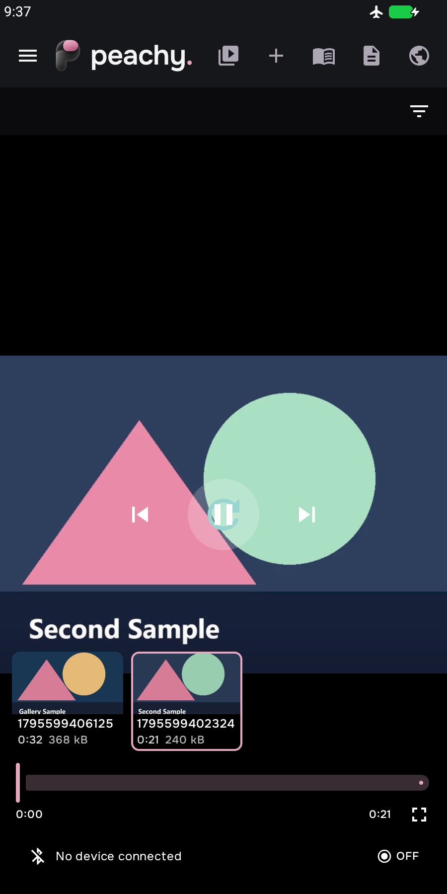
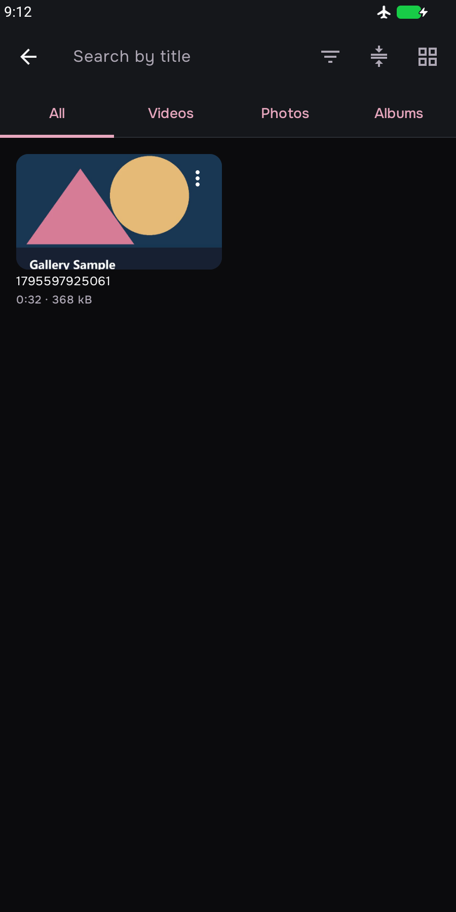
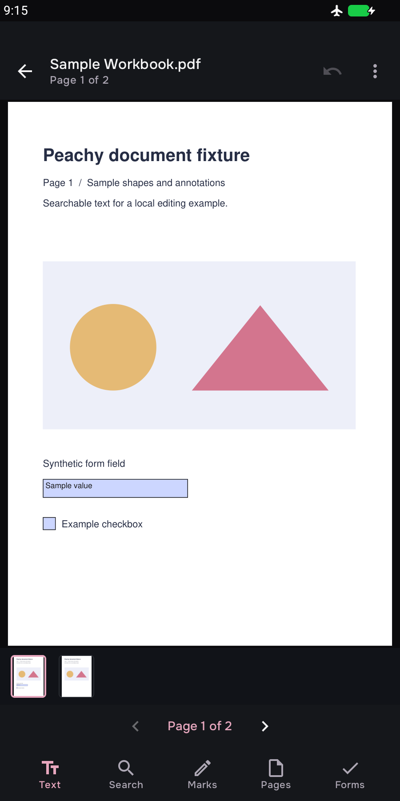
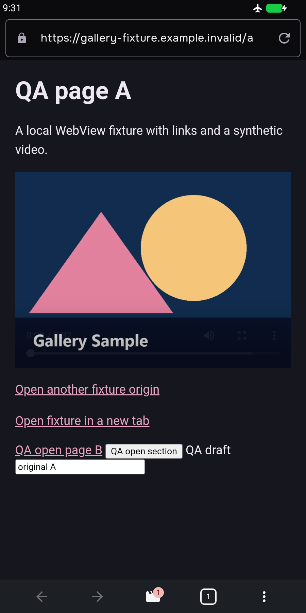

# Peachy 0.9.3 · каталог интерфейса Android

Основной каталог версии `v0.9.3` (`f0ad561`) содержит **63 сценария и 153 кадра**. В разделе [«Манга»](#манга) доступны ещё 10 кадров с открытой тестовой страницей, настройками и результатом OCR. Ссылки открывают PNG в полном разрешении.

| Плеер | Галерея | PDF | Браузер |
| --- | --- | --- | --- |
|  |  |  |  |

## Условия съёмки

- Исходная версия собрана через `:app:assembleDebug` с `-Ppeachy.browserQa=true`. Проверены идентификатор изолированного пакета `ru.spgsroot.peachy.browserqa`, версия `0.9.3` (код `19`), отладочная подпись, четыре JNI ABI и выравнивание для страниц 16 КиБ. SHA-256 установленного APK — `6aa24346d6dde696832060113c0c9da2593908723dfe100b0e6dd2294b58e876`.
- Одноразовый Android Emulator, Android 17.1 (API 37), x86_64, страница памяти 16 КиБ, интерфейс на английском, 900 × 1800 в портретном режиме. Полноэкранные состояния могут менять ориентацию. Системные диалоги показывают имя изолированного пакета **Peachy Browser QA**. Использована штатная политика снимков debug.
- Эмулятор работал офлайн. Медиа, документы, парольные формы и архив использовали одноразовые синтетические данные. Для манги использована [инструментальная фикстура проекта](../../app/src/androidTest/java/ru/spgsroot/peachy/manga/MangaFixtureSeedTest.kt). В WebView загружены локальные ответы и MP4 на зарезервированном домене `.invalid` через инструментальный перехватчик по схеме [теста навигации](../../app/src/androidTest/java/ru/spgsroot/peachy/ui/webview/BrowserNavigationTest.kt). Перевод и подключение устройств использовали локальные протокольные фикстуры. Сняты экраны работающего приложения и Android.
- Инвентарь сверялся с [манифестом](../../app/src/main/AndroidManifest.xml), [маршрутами приложения](../../app/src/main/java/ru/spgsroot/peachy/MainActivity.kt) и доступными из них экранами, настройками и диалогами. Входы — `MainActivity`, `WebViewActivity` и `ShareReceiverActivity`. **BLOCKED** означает ограничение сборки, эмулятора или офлайн-среды. **NOT RUN** указывает на конкретное состояние без отдельного кадра. Снимки показывают визуальные состояния и не заменяют функциональные проверки.

## Онбординг и доступ

| Функция или состояние | Кадры | Условия и пробелы |
| --- | --- | --- |
| Первый запуск | [01](01-onboarding.png) | Чистый профиль эмулятора. |
| Установка и подтверждение PIN | [02](02-password-setup.png) | Оба поля показаны пустыми. |
| Блокировка, неверный PIN и разблокировка | [04](04-lock.png) · [05](05-lock-rejected.png) · [03](03-player-empty.png) | Проверено после перезапуска процесса. Форма очищает неверный PIN. |

## Плеер и импорт

| Функция или состояние | Кадры | Условия и пробелы |
| --- | --- | --- |
| Пустая очередь и выбор источника | [03](03-player-empty.png) · [06](06-player-add.png) | Чистая локальная медиатека. |
| Ввод URL и пакетный список ссылок | [07](07-player-url.png) · [08](08-player-import-list.png) | Штатные формы импорта. |
| Системный выбор видео | [09](09-media-picker.png) · [09b](09b-media-picked.png) · [14](14-player-imported.png) | Два доступных синтетических MP4, выбор одного видео за операцию. |
| Воспроизведение и панель очереди | [15](15-player-playing.png) · [14](14-player-imported.png) | Медиафайлы созданы локально. |
| Очередь из двух клипов, переключение и полноэкранный режим | [130](130-player-queue.png) · [15](15-player-playing.png) · [131](131-player-fullscreen.png) | Два локальных видео добавлены по одному через системный Photo Picker. Показаны пауза/воспроизведение, перемотка и выбранный клип. |
| Повторный импорт и обработка дубликата | [135](135-media-duplicate.png) | Повторно выбран существующий MP4. Диалог предлагает пропустить или всё равно добавить. |
| Способ загрузки и выбор браузера | [07](07-player-url.png) · [137](137-download-external-option.png) · [136](136-browser-launch-dialog.png) | Внутренняя загрузка, передача другому приложению, опциональная папка копий и диалог запуска WebView из меню добавления. |
| Отказ загрузчика для локального URL | [138](138-download-local-state.png) | **BLOCKED** для успешной загрузки в офлайн-среде. Штатный загрузчик требует публичный адрес и отклонил адрес обратного проброса ADB. |

## Медиатека

| Функция или состояние | Кадры | Условия и пробелы |
| --- | --- | --- |
| Галерея без файлов и с импортом | [10](10-gallery-empty.png) · [17](17-gallery-videos.png) | Фото и видео используют синтетическую геометрию. |
| Фильтры, порядок сортировки и сетка | [11](11-gallery-filter.png) · [12](12-gallery-layout.png) | Поиск, тип и параметры размера доступны из галереи. **NOT RUN** для отдельных результатов текстового поиска. |
| Альбомы | [13](13-gallery-albums-empty.png) | Начальное состояние. |
| Меню видео, переименование и заметка | [18](18-gallery-video-menu.png) · [19](19-gallery-rename.png) · [20](20-gallery-note.png) | Диалоги реальной карточки. |
| Смена обложки | [23](23-gallery-cover.png) | Android Photo Picker для локального изображения. |
| Сжатие видео | [21](21-gallery-compress.png) · [22](22-gallery-compress-run.png) | Пресеты и пользовательский режим, при попытке сжать маленькую фикстуру файл был пропущен. |
| Мультивыбор и удаление | [24](24-gallery-selected.png) · [25](25-gallery-delete.png) | Удаление в этой версии выполняется действием панели. |
| Пополнение галереи и просмотр фото | [132](132-gallery-populated.png) · [123](123-gallery-photo.png) · [124](124-gallery-photo-viewer.png) · [125](125-gallery-photo-menu.png) | Собственные синтетические JPEG и MP4, полноэкранная фотография и её меню. |
| Создание альбома, перемещение и управление альбомом | [126](126-gallery-move-album.png) · [127](127-gallery-create-album.png) · [128](128-gallery-album.png) · [128b](128b-gallery-album-open.png) · [129](129-gallery-album-menu.png) | Синтетический альбом с локальным изображением. |
| Экспорт двух выбранных видео | [133](133-gallery-batch-selected.png) · [26](26-gallery-export.png) · [32](32-documents-picker.png) | Android DocumentsUI запросил папку. Два экспортированных MP4 видны в системном списке. |

## Документы

| Функция или состояние | Кадры | Условия и пробелы |
| --- | --- | --- |
| Пустой и заполненный список, фильтры и системный выбор | [30](30-documents-empty.png) · [40](40-documents-list.png) · [31](31-documents-filter.png) · [32](32-documents-picker.png) | PDF, изображения и Office открываются из системного выбора. |
| Редактор изображения, кадрирование, поворот и свет | [33](33-image-editor.png) · [34](34-image-crop.png) · [35](35-image-rotate.png) · [36](36-image-light.png) | Синтетический JPEG. |
| Кисть, изменение и отмена/повтор | [37](37-image-brush.png) · [38](38-image-ink.png) | Штрих нанесён на синтетическое изображение. |
| Копия изображения и выход с изменениями | [39](39-image-export.png) · [39b](39b-image-unsaved.png) · [39d](39d-image-saved.png) | Выбор PNG/JPEG, системное сохранение и подтверждение. |
| Просмотр PDF, навигация и миниатюры | [41](41-pdf-editor.png) · [43](43-pdf-pages.png) | Двухстраничный PDF с текстовым слоем, векторной графикой и полями. |
| Формы PDF | [42](42-pdf-forms.png) | Поля синтетического PDF и элементы управления. |
| Отметки PDF | [44](44-pdf-marks.png) | Меню заметок, текста и рисования. |
| Поиск по PDF | [45](45-pdf-search.png) · [46](46-pdf-search-results.png) · [46b](46b-pdf-search-match.png) | Панель, пустой результат и переход между двумя совпадениями. |
| Экспорт текста и копии PDF | [47](47-pdf-menu.png) · [49e](49e-pdf-unsaved.png) · [49f](49f-pdf-copy-picker.png) | Сохранение изменённой копии прошло через Android DocumentsUI. |
| Рисованная и криптографическая подпись PDF | [48](48-pdf-signatures.png) · [48b](48b-pdf-signature-pad.png) · [48c](48c-pdf-signed-ink.png) | Рисованная подпись синтетическая. Панель показывает вход в ветку PKCS#12. **NOT RUN** для завершённой криптографической подписи. |
| Экспорт страниц PDF | [49](49-pdf-export-folder.png) · [49b](49b-pdf-export-grant.png) · [49c](49c-pdf-export-options.png) · [49d](49d-pdf-exported.png) | Выбор папки, Android-разрешение, формат и разрешение растровой копии. |
| Защищённый PDF | [50](50-pdf-locked.png) · [50b](50b-pdf-wrong-password.png) | Запрос пароля и отказ. Поле ввода на кадре отказа закрыто заливкой. |
| Удаление сеанса документа | [51](51-documents-delete.png) | Запрос подтверждения. |
| Word, Excel и PowerPoint | [52](52-office-word.png) · [53](53-office-excel.png) · [54](54-office-powerpoint.png) · [55](55-documents-with-office.png) | **BLOCKED.** Редактор Office отключён в исходниках этой версии. Показаны реальные экраны импортированных DOCX, XLSX и PPTX. |
| Выделение и замена текста PDF | [46c](46c-pdf-text-selection.png) · [46d](46d-pdf-replace-text.png) · [46e](46e-pdf-confirm-replacement.png) · [46f](46f-pdf-text-replaced.png) | Действия с выделением, предварительный просмотр, подтверждение замены в оригинальной строке и изменённая рабочая копия. |

## Настройки

| Функция или состояние | Кадры | Условия и пробелы |
| --- | --- | --- |
| Условный переключатель, таймер и скорость | [60](60-settings.png) · [67](67-settings-conditional.png) | Разделы манги, устройств и перевода появляются после включения. |
| Выбор языка интерфейса | [61](61-language-menu.png) | Доступны системный, русский и английский. |
| Смена PIN | [62](62-change-password.png) | Показаны пустые поля. |
| Проверка обновлений, автоматическая проверка и статус | [60](60-settings.png) · [63](63-update-status.png) | **BLOCKED.** Эмулятор офлайн. Получено сообщение об отсутствии соединения. Просмотр нового релиза, скачивание, проверка и системная установка здесь недоступны. |
| Резервная копия, поддержка и ссылки проекта | [64](64-settings-backup-support.png) | Адрес поддержки закрыт непрозрачной заливкой. |
| Шифрованный экспорт и импорт архива | [65](65-vault-export.png) · [65b](65b-vault-save-picker.png) · [65c](65c-vault-result.png) · [66](66-vault-import.png) · [66b](66b-vault-result.png) | Локальный архив одноразового профиля. Формы сняты с пустыми полями пароля. |

## Устройства

| Функция или состояние | Кадры | Условия и пробелы |
| --- | --- | --- |
| Подключение и настройка DSP | [69](69-device-collapsed.png) · [70](70-device-expanded.png) · [71](71-device-scan-dialog.png) | Условный раздел. Доступны полоса, сглаживание, порог и усиление. |
| Поиск, выбор активного устройства и отключение | [71b](71b-device-search.png) · [72](72-device-results.png) · [73](73-device-active.png) · [74](74-device-disconnected.png) | Два виртуальных кандидата от локальной фикстуры протокола. Финальный ответ сканирования показывает ошибку при наличии кандидатов в списке. **BLOCKED** для физического поиска и физического отклика. |

## Манга

**[Манга в версии 0.9.4: примеры без масок](../screens-v0.9.4/)**. Ниже — исходные кадры и ограничения прогона 0.9.3.

| Функция или состояние | Кадры | Условия и пробелы |
| --- | --- | --- |
| Навигация, поиск и фильтры каталога | [80](80-manga-catalog.png) · [81](81-manga-filters.png) · [82](82-manga-recent.png) · [83](83-manga-navigation.png) | История запросов синтетическая. **BLOCKED** для онлайн-выдачи, случайной галереи и скачивания из каталога. |
| Рекомендации «Для вас» | [84](84-manga-for-you.png) | **BLOCKED.** Онлайн-каталог недоступен в офлайн-прогоне. |
| Загрузки, избранное и история чтения | [85](85-manga-favorites.png) · [86](86-manga-history.png) · [87](87-manga-downloads.png) | Два локальных синтетических произведения из инструментальной фикстуры проекта. |
| Детали, избранное, просмотр страниц и возобновление | [88](88-manga-detail.png) · [90](90-reader-controls.png) | Продолжение на странице 6 из 12. **BLOCKED** для внешних метаданных, комментариев и похожих галерей. |
| Ориентация, подгонка, жесты, зум, прокрутка и настройки перелистывания | [91](91-reader-settings.png) · [90](90-reader-controls.png) | Штатная панель открыта поверх читалки. Смена страницы показана счётчиком в кадре локального OCR. |
| Способы распознавания, язык и режимы перевода | [92](92-reader-ocr-settings.png) · [92c](92c-reader-mlkit.png) · [92b](92b-reader-translation-modes.png) · [92d](92d-reader-on-turn.png) · [92e](92e-reader-whole.png) | Параметры видны в читалке, включая режимы запроса, пузырей, перелистывания и всей галереи. |
| Провайдер и список моделей | [68](68-provider-setup.png) · [68b](68b-provider-models.png) | Список моделей получен от локального тестового HTTP-эндпоинта. **BLOCKED** для проверки внешних провайдеров, реальных тарифов и замеров. |
| Согласие и результат перевода | [93](93-reader-translation-consent.png) · [94](94-reader-translation.png) · [94b](94b-reader-translation-expanded.png) | Локальная фикстура возвращает синтетический ответ. Внешний Vision-сервис не вызывался. |
| Локальный OCR и раскрытая панель текста | [95b](95b-reader-local-ocr-expanded.png) | ML Kit распознал подписи на седьмой синтетической странице. Ответ перевода подставил локальный HTTP-эндпоинт. Распознанный текст и перевод закрыты. |
| Закладка страницы, сохранённые страницы и мультивыбор | [96](96-reader-bookmarked.png) · [97](97-manga-saved-pages.png) · [97b](97b-manga-saved-selection.png) | Видны входы в экспорт и удаление выбранных страниц. |
| Теги, персонажи, избранное и коллекции тегов | [98](98-manga-tags.png) · [98b](98b-manga-tag-favorites.png) · [98c](98c-manga-tag-collections.png) · [99](99-manga-characters.png) | Офлайн-экраны поиска и организации тегов. **BLOCKED** для каталога тегов и персонажей. |

### Чтение и перевод на тестовой странице без масок

| Действие | Что видно |
| --- | --- |
| Найти и открыть страницу | [История запросов](examples/82-manga-recent.png) · [навигация по миниатюрам](examples/90-reader-controls.png) · [настройки чтения](examples/91-reader-settings.png) |
| Выбрать способ перевода | [Vision или локальный ML Kit](examples/92-reader-ocr-settings.png) · [режим перевода и язык](examples/92b-reader-translation-modes.png) · [согласие на отправку](examples/93-reader-translation-consent.png) |
| Прочитать оригинал и перевод | [Панель Vision](examples/94b-reader-translation-expanded.png) · [текст, распознанный ML Kit на странице 7](examples/95b-reader-local-ocr-expanded.png) |
| Вернуться к сохранённой странице | [Закладка в читалке](examples/96-reader-bookmarked.png) · [выбор страниц для экспорта или удаления](examples/97b-manga-saved-selection.png) |

Страницы нарисованы для теста. ML Kit распознал их подписи на устройстве. Вместо внешнего провайдера локальный сервер вернул фиксированный ответ на английском, в том числе при выбранном португальском. Эти кадры показывают работу панели, но не качество перевода.

## Браузер

| Функция или состояние | Кадры | Условия и пробелы |
| --- | --- | --- |
| Стартовая страница, меню, адрес и навигация | [100](100-browser-start.png) · [102](102-browser-menu.png) · [107](107-browser-local-page.png) · [115](115-browser-local-page-b.png) | Настоящий WebView на локальных фикстурах, адрес, переход между страницами и кнопки назад/вперёд. |
| Обзор вкладок, создание и закрытие | [101](101-browser-tabs.png) · [101b](101b-browser-two-tabs.png) · [110](110-browser-popup-confirm.png) | Подтверждение открытия новой вкладки по ссылке. |
| Закладки, история посещений и заметка | [111](111-browser-local-menu.png) · [112](112-browser-bookmarks.png) · [113](113-browser-history.png) · [114](114-browser-note.png) | Посещение и закладка ведут на локальную страницу. Диалог заметки открыт. |
| Блокировка по сайту, статистика, правила и подписки | [111](111-browser-local-menu.png) · [103](103-browser-shield.png) · [103b](103b-browser-shield-lists.png) | **BLOCKED** для сетевого обновления подписок. Показано сообщение об ошибке и сохранении прежних списков. |
| Очистка данных сайтов | [104](104-browser-clear-site-data.png) | Диалог подтверждения с описанием последствий. |
| Поиск видео и действие сохранения | [105](105-browser-videos-empty.png) · [107b](107b-browser-playing.png) · [108](108-browser-detected-video.png) | Пустой список и обнаруженный MP4. **BLOCKED** для успешной загрузки из WebView: тестовый перехватчик обслуживает WebView, отдельный сетевой загрузчик офлайн. |
| Разрешения для захвата звука | [106](106-browser-audio-consent.png) · [106b](106b-browser-media-projection.png) · [106c](106c-browser-projection.png) | Штатные Android-запросы разрешения на уведомления, микрофон и MediaProjection. Захват отменён на системном экране. **BLOCKED** для отклика физического устройства. |

## Внешний импорт

| Функция или состояние | Кадры | Условия и пробелы |
| --- | --- | --- |
| ShareReceiverActivity и блокировка внешнего импорта | [120](120-android-share.png) · [121](121-share-auth.png) · [122](122-share-import-result.png) · [123](123-gallery-photo.png) | Уникальный синтетический JPEG из Android Files с реальным URI и разрешением на чтение. Импорт отложен до входа. **NOT RUN** для отдельных входов с видео, несколькими URI и ссылкой. |

## Цензура и проверка

В основном каталоге содержимое манги закрыто непрозрачной заливкой: обложки, миниатюры, страницы, названия, запросы истории, OCR и перевод. Та же обработка применена к полю пароля на кадре отказа PDF и адресу поддержки. В `examples/` открыты только синтетические данные.

Каждый финальный PNG просмотрен. Для размеченных областей основного каталога проверено совпадение пикселей с цветом заливки. Файлы пересохранены как однослойные RGB PNG. Проверка контейнера допускает только `IHDR`, `IDAT` и `IEND`, без метаданных, встроенных превью и добавленных данных.

[Исторические снимки](../screens/) относятся к прежнему интерфейсу.
