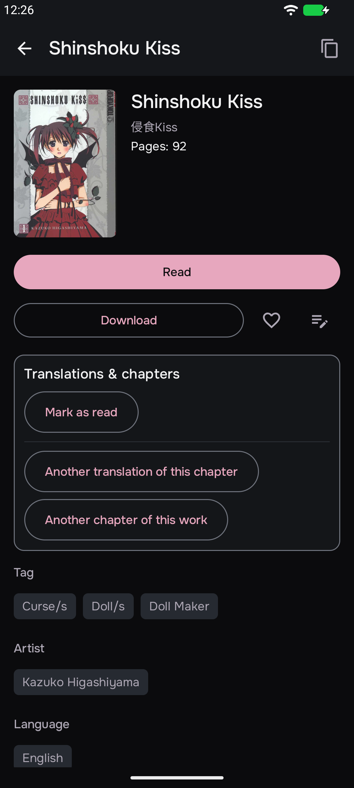
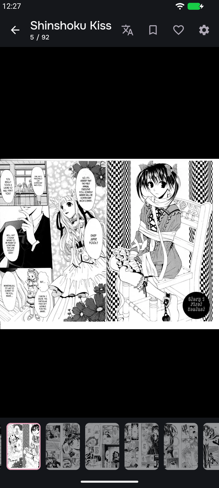
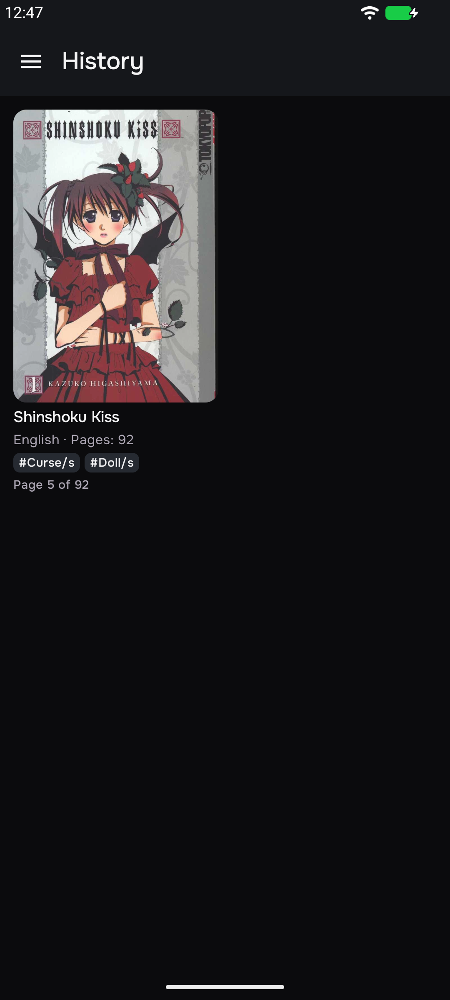
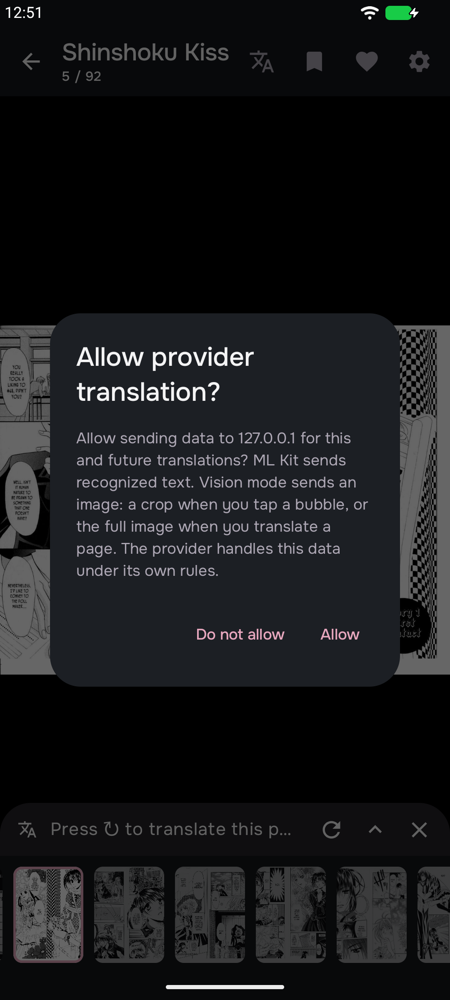
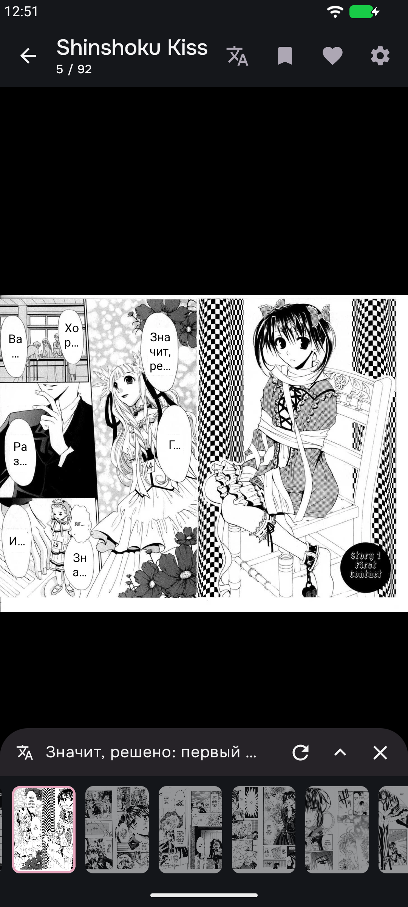
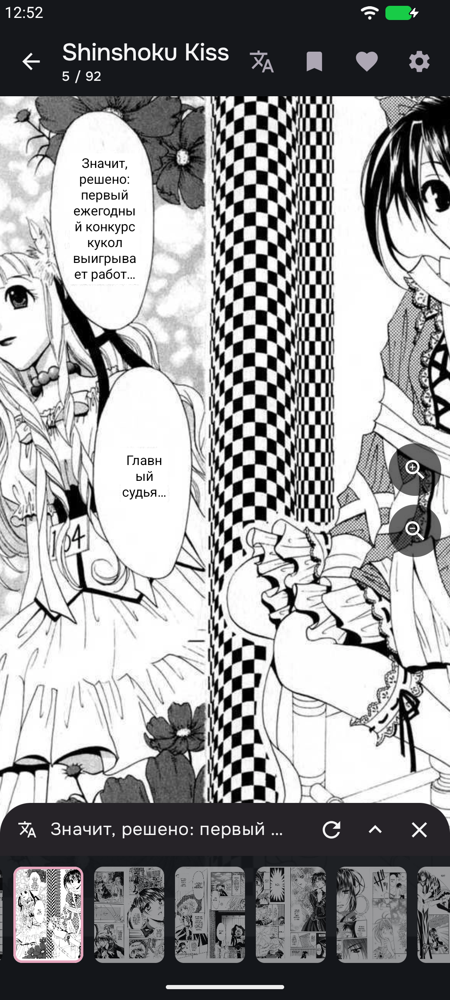
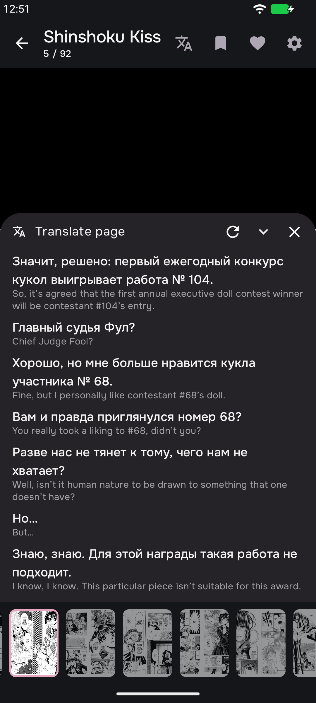

# Манга в Peachy 0.9.4

[Все разделы приложения: плеер, галерея, документы, настройки, устройства и браузер](../screens-v0.9.3/) · [OCR на устройстве и режимы перевода](../screens-v0.9.3/#чтение-и-перевод-на-тестовой-странице-без-масок)

## Найти, прочитать и сохранить

На экранах — [*Shinshoku Kiss* Кадзуко Хигасиямы](https://comix.to/title/vv2n0-shinshoku-kiss). Для съёмки использована локальная копия [первого тома, 92 страницы](https://comix.to/title/vv2n0-shinshoku-kiss/7458299-chapter-0). Это не интеграция Peachy с Comix. Нажмите на миниатюру, чтобы рассмотреть экран в полном размере.

| Каталог | Карточка | Чтение | История |
| --- | --- | --- | --- |
|  |  |  |  |

| Что сделать | Где посмотреть |
| --- | --- |
| Найти мангу | [Меню разделов](drawer.png) → [фильтр по языку, тегам, дате и сортировке](filters.png). [Список тегов](tags.png) → [собственная коллекция с тегом](tag-collection.png). |
| Оставить на потом | [Загрузки](library.png) · [избранное](favorites.png) · [личная заметка к карточке](note.png). |
| Настроить чтение | [Постраничный режим и жесты](reader-settings.png) · [вертикальная непрерывная прокрутка, ширина страницы и кнопки зума](continuous.png) · [продолжение чтения со страницы 5](resume.png). |
| Сохранить отдельную страницу | [Активная закладка в читалке](bookmark.png) → [сохранённые страницы](saved-pages.png) → [выбор для экспорта или удаления](saved-selection.png). При экспорте страницы 5 в Android Documents получен файл 1456 × 1130 с тем же изображением, что в локальном выпуске. |

## Перевод страницы

| Перед отправкой | Перевод на рисунке | При увеличении | Полный текст |
| --- | --- | --- | --- |
|  |  |  |  |

На странице выбран русский язык. После согласия Peachy отправил один запрос локальному серверу. Сервер вернул заранее подготовленные реплики и координаты этой страницы. На кадрах видна работа читалки: короткий текст на рисунке, перенос при увеличении, оригинал и полный перевод в панели. Это не результат и не оценка внешней модели.

## Связать переводы и главы

Чтобы не приписывать *Shinshoku Kiss* несуществующие переводы, здесь используются **вымышленные издания DEMO**. Это рабочие компоненты интерфейса и хранилище Room версии 0.9.4 в изолированном Android-сценарии, а не полный экран приложения.

| Шаг | Что меняется |
| --- | --- |
| 1. Раскрыть [автогруппу](identity/01-probable-translations-collapsed.png) | [Два вероятных перевода](identity/02-probable-translations-expanded.png) показываются вместе. Само совпадение не переносит отметку о прочтении. |
| 2. [Отметить русское издание прочитанным](identity/03-mark-own-read.png) | [У английского издания до подтверждения](identity/04-translation-before-confirmation.png) нет унаследованной отметки. |
| 3. Подтвердить «перевод этой главы» | [У английского издания появился статус «Прочитано в другом переводе»](identity/05-confirmed-inherited-read.png). |
| 4. [Добавить другую главу произведения](identity/06-link-different-chapter-dialog.png) | [Глава 1.5 входит в то же произведение, но остаётся непрочитанной](identity/07-different-chapter-linked-unread.png). |
| 5. Отвязать перевод | [У английского издания исчезла унаследованная отметка](identity/08-unlinked-inheritance-removed.png); собственная отметка русского издания сохранилась. |

Съёмка: Android Emulator, API 37, x86_64, страницы памяти 16 КиБ. Для *Shinshoku Kiss* использована отладочная сборка на базе `v0.9.4` с локальными ответами каталога и файлами страниц. Оригиналы главы, APK и тестовый сервер в галерею не входят. Для экранов остальных функций условия и непроверенные сценарии указаны в [каталоге 0.9.3](../screens-v0.9.3/).
